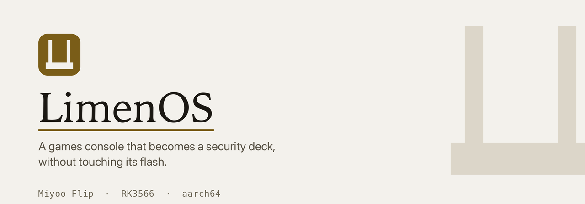
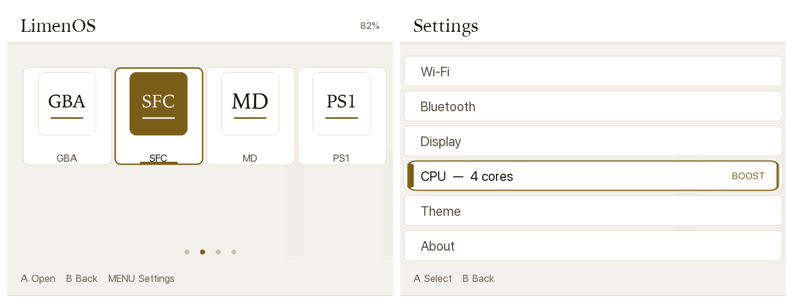

<div align="center">

<picture>
  <source media="(prefers-color-scheme: dark)" srcset="images/banner-dark.png">
  
</picture>

<br>

**A security-work firmware for the Miyoo Flip.**

[](https://github.com/at0m-b0mb/LimenOS/releases/latest)
[](LICENSE)
[](docs/01-hardware-ground-truth.md)
[](docs/05-toolkit.md)
[](https://at0m-b0mb.github.io/LimenOS/)

[Quickstart](docs/06-quickstart.md) · [Ground truth](docs/01-hardware-ground-truth.md) · [Architecture](docs/02-architecture.md) · [Roadmap](docs/03-roadmap.md) · [Ceilings](docs/04-constraints.md) · [Scope](SCOPE.md)

</div>

---

> **LIMEN** — Latin, *threshold*: the stone at the foot of a doorway, the line
> you step over. A clamshell handheld opens at a threshold, and security work is
> boundary work — deciding what may cross, and proving what did.

Turns a Miyoo Flip (`miyoo355` / Rockchip RK3566) into a pocket Linux deck for
authorised security testing — packet capture, hardware and UART work, HID gadget
payloads, scanning and analysis — **without ever writing to the console's
internal flash.** Card in, LimenOS. Card out, your games console, bit-for-bit as
it shipped.

## The one-paragraph version

The Flip is a **better hardware-hacking tool than it is a Wi-Fi tool**, and
nobody says so. Its stock kernel already gives you `AF_PACKET` raw sockets, a
USB **HID gadget**, native **CP210x/FTDI/PL2303** serial drivers and a real
powered host port — so capture, scanning, keystroke injection and UART work all
run on the firmware you have today. What it does *not* have is a single USB
Wi-Fi driver beyond its own soldered-on radio, no `TUN`, no `BRIDGE`, no
`nftables`, no conntrack or NAT, and no USB-Ethernet. Plug an Alfa in and
nothing binds. So LimenOS is two projects: a Debian userland you can have in an
afternoon, and a kernel that makes the wireless half real.

## Confirmed on hardware — 2026-11-13

M1 runs on a real Miyoo Flip. The device's kernel build string is
byte-identical to the analysed image, so every static finding applies to it
exactly.

| Verified on the device | Result |
|---|---|
| Root code execution from the SD card at boot | works, via the vendor's own hook, console still boots normally |
| Debian trixie arm64 chroot | **455 packages**, `nmap` / `tcpdump` / `scapy` / `iw` / `binwalk` / `flashrom` all executing |
| `AF_PACKET` capture | live traffic captured, **zero dropped packets** |
| Which radio | `0bda:b733` — **RTL8733BU**, dual-band (14 × 2.4 GHz, 28 × 5 GHz) |
| **Monitor mode** | ❌ **NOT SUPPORTED — measured** |
| Security toolkit | **34 / 34 tools execute** |
| BadUSB / HID gadget | works — `/dev/hidg0`, correct keycodes |
| CPU | **2 of 4 cores were offline**; enabling them = **2.26×** |
| zram | 1500 MB allocated on a 957 MB machine |
| Thermals | 79 °C after 3 min at full load, no throttling |

```
# iw phy phy1 interface add mon0 type monitor
command failed: Operation not supported (-95)
```

The driver advertises only `IBSS / managed / AP / P2P-client / P2P-GO`. This
was previously documented as "plausible but unproven"; it is now proven,
negatively. No userland tooling changes it — it needs a different driver,
which needs a different kernel. **That is exactly what M2 is for.**

Full measurements: [docs/01 §8](docs/01-hardware-ground-truth.md) and the
[hardware test report](docs/07-hardware-test-report.md).

## Measured, not assumed

Every hardware claim comes out of a stock firmware image and is reproducible —
including the live kernel configuration, decompressed from the `IKCFG_ST` blob
inside the shipped kernel.

| Finding | Why it matters |
|---|---|
| `CONFIG_RTL8733BU=y` is the **only** WLAN driver | **0/10** external adapter families supported. Built in, so not even swappable. |
| `CONFIG_PACKET=y` | tcpdump / scapy / nmap work **today** |
| `CONFIG_USB_CONFIGFS_F_HID=y` | **BadUSB works today** — no custom firmware |
| `CONFIG_USB_SERIAL_{CP210X,FTDI,PL2303}=y` | hardware & UART work **today** (**not** CH340) |
| No `MODULE_SIG`, `MODULE_FORCE_LOAD=y` | unsigned out-of-tree drivers load freely |
| `TUN`, `BRIDGE`, `NF_TABLES`, `NF_CONNTRACK` absent | no VPN, bridging, nftables or NAT |
| 128 MB NAND, `dd`-to-MTD updater, no A/B slot | the OS **cannot** live internally, and flashing it is unsafe |

Check it yourself:

```bash
./build/02-audit-kernel-config.sh research/stock-firmware/stock-kernel-5.10.160.config
```

## A theme for the stock launcher



The Flip's launcher is themeable, and `system.json` simply points at a folder
under `Themes/`. So LimenOS ships one, in the same warm-paper-and-gold palette
as the rest of the project:

```bash
python3 tools/themekit.py && ./build/30-install-theme.sh
```

`themekit.py` generates all 170 assets from code — backgrounds, bars, list
items, game cards, buttons, popup menus and 69 system icons in both normal and
selected states — at the exact pixel sizes the launcher expects.

**The installer is purely additive.** It adds one folder and deletes nothing:
your games, saves, apps and existing themes are untouched, and it will not even
edit `system.json` unless you pass `--activate`. Switch with
**Settings → Theme → LimenOS**, and switch back the same way.

## Try it before you build anything

This needs **no custom firmware at all** — it runs on the Miyoo firmware already
on your device. Copy [`device/limen-hid`](device/limen-hid) across, then:

```bash
limen-hid enable && limen-hid type "hello from a games console"
```

Plug the **lower** USB-C into a laptop and watch it type. The keymap is verified
by [`tests/test-hid-keymap.py`](tests/test-hid-keymap.py), which decodes the
emitted HID reports with an independently written usage table and checks all
**95 printable ASCII characters** and every modifier combination round-trip.
Running a Ducky script requires an explicit `--arm`, because keystroke injection
is an active attack and should never be one typo away.

## Roadmap

| | Milestone | Needs | Gives you |
|---|---|---|---|
| **M0** | Safety net | a USB-UART, an SD card | NAND dump, serial console, known radio part |
| **M1** | *Limen Lite* | **no kernel work** | capture, scanning, BadUSB, serial work, web tooling |
| **M2** | *Limen* | the real engineering | external adapters, monitor mode, injection, VPN, nftables |
| **M3** | The deck UX | design work | 640×480 D-pad TUI, on-screen keyboard, one-button `ssh limen.local` |

**Start at M0.** It costs one cable and makes everything after it reversible.

## Build it

```bash
./build/10-build-rootfs.sh && ./build/11-make-card.sh
```

Debian trixie arm64, 455 packages, built with debootstrap in a native-arm64
container. Kali's repo is pinned to priority 100 so it supplies tools and can
never replace the base system. The card builder populates filesystems with
`mkfs.ext4 -d` and `mcopy` — no loop devices, no privileged mounts — and
**never touches a device node**; writing the card is a separate step you run
yourself.

## Honesty ceilings

~1 GB RAM, 4× Cortex-A55, **no usable GPU compute — hashcat will not accelerate
here.** This is a capture-and-analyse deck, not a cracking rig. One host port,
and the lower USB-C cannot power a bus-powered adapter. Monitor mode on the
internal radio is *plausible but unproven*. The full list, with reasons, is in
[docs/04-constraints.md](docs/04-constraints.md) — read it before getting
attached to an idea.

## Layout

```
docs/      measured hardware facts, architecture, roadmap, ceilings, quickstart
build/     firmware teardown, kernel auditor, rootfs and card builders
device/    NAND backup, hardware identification, HID gadget, chroot entry
kernel/    the deck kernel config fragment — every option, with reasons
overlay/   limen-zram, limen-radio, limen-capture
tools/     brandkit — rebuilds every brand asset from source
tests/     HID keymap verified against an independent HID usage table
research/  the extracted stock kernel config, DTB and init scripts
```

## Scope

For networks and devices you own, or engagements with written permission — no unattended attack modes, no jamming, no deauth floods.

See [SCOPE.md](SCOPE.md) for the full statement.

## Prior art

[CarlOS](https://github.com/CarlosPix/CarlOS) ·
[Surwish](https://github.com/Surwish/Surwish-Miyoo-Flip) ·
[GammaOS Core](https://github.com/TheGammaSqueeze/GammaOSCore) ·
[MinUI](https://github.com/shauninman/MinUI) — gaming frontends on the vendor
kernel; useful for boot-chain reference, none touch the radio stack.
[Zetarancio's RE wiki](https://github.com/Zetarancio/Miyoo-Flip-Mainline-Linux-Reverse-Engineering)
and the ROCKNIX Flip fork → Zlyme are the mainline lineage M2 builds on.
[baseos-my355](https://github.com/apommel/baseos-my355) is the minimal-boot reference.

<div align="center">
<br>
<sub>Built by <a href="https://github.com/at0m-b0mb">at0m-b0mb</a> · MIT</sub>
</div>
